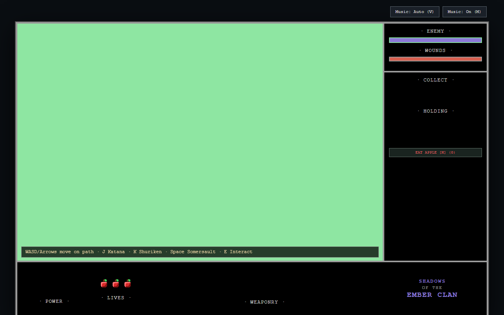

# Shadow of the Ember Clan

A modern 3D isometric rebuild of **The Last Ninja** with a twist — blending classic C64-inspired pixel aesthetics, multi-region maze exploration, and chiptune synthesis with Three.js 3D isometric action, kneeling shrine prayer healing, weapon switching, and dynamic boss encounters. Open **index.html** (or **threejs.html**) in a modern browser, or double-click **Play.cmd** on Windows. No install, account, download or build step is required. Use fullscreen for the strongest presentation.

## Demo

## Play

WASD/arrows move in screen directions; **J** sword, **K** shuriken, **Space** dodge, **Shift** guard, **E** interact, **Tab** map, **Esc/P** pause, **M** music. Hold J for follow-up attacks. Nearby foes are automatically targeted when attacking. Watch enemy windup markers and use guard or dodge. A controller or on-screen touch controls can also be used; see the in-game guide.

Recover all three relics, activate the numbered puzzle stones in Sora's order, then use the northern altar to summon a guardian. Defeat it and use the altar again to continue. Repeat through the five regions to reach the ending and credits. Each region has a unique clue, environment, original musical pattern and guardian.

Rest at a lantern shrine to heal, refill shuriken and save. Death and Continue restore the last checkpoint, not every action since it. Save data is local to the browser/profile/origin; opening the game from a different path, clearing browser storage or switching browser may make a prior save unavailable. The game reports storage failure and retains a checkpoint for the current session. Choose Story difficulty before starting for gentler combat.

## Files

- BUILD.md — scope and implementation gates.
- GAME_LAYOUT.md — story, levels, puzzles, presentation and controls.
- VALIDATION.md — verification evidence and remaining limits.
- assets/ — exported original sprite atlas and asset inventory.
- concepts/ — approved visual direction and generated presentation artwork.
- core.js — DOM-independent simulation, campaign and saves.
- art.js / render.js — original pixel sprites and isometric scene renderer.
- audio.js — original locally synthesized music and effects.
- game.js — controls, menus, transitions and storage.

For browser QA, serve the folder with `python -m http.server 8765`, then open `http://localhost:8765`. The game also runs directly from disk.

## Credits

Creative direction and concept approval: the user. Implementation, procedural sprites/scenery and original synthesized score: Codex with OpenAI. Loading and cinematic illustrations: OpenAI image generation. Inspired by The Last Ninja from System 3 and its celebrated musical atmosphere. This independent game contains no copied Last Ninja sprites, recordings, melodies or branding. No external libraries are required at runtime.
