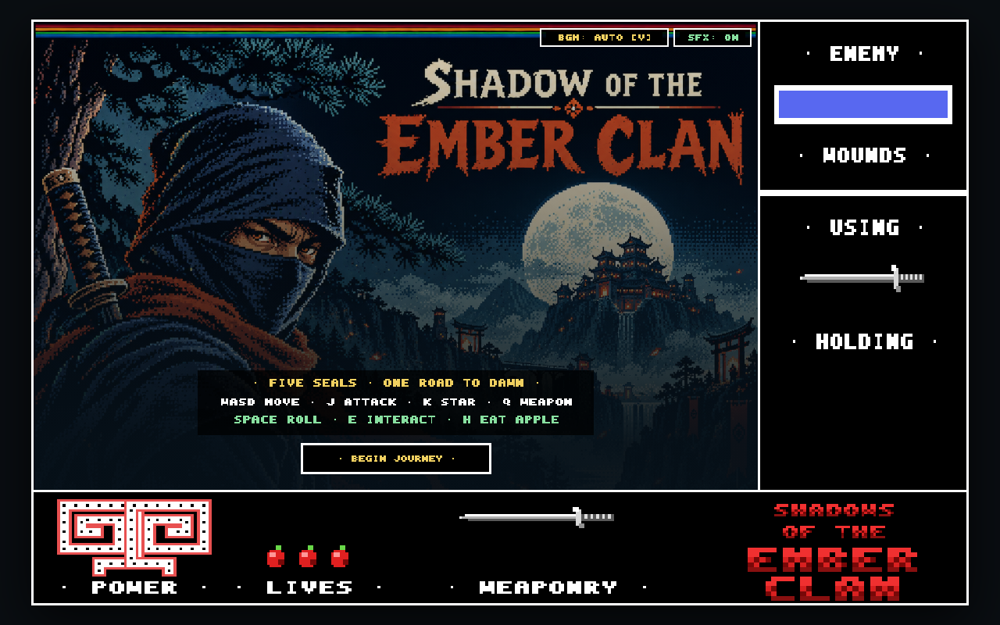
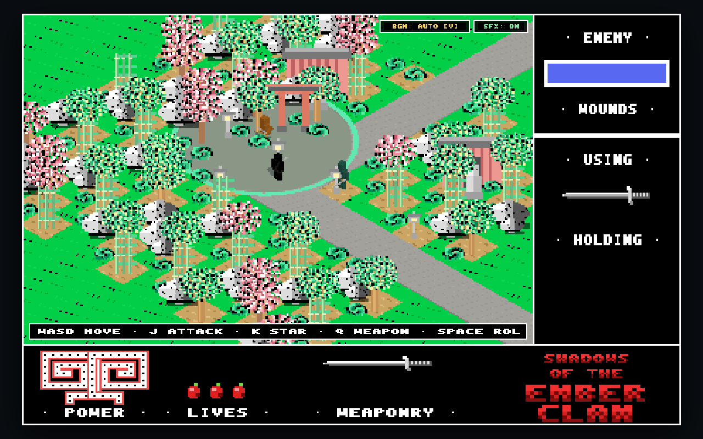

# Shadow of the Ember Clan

> **Status: Work in Progress (WIP)** — This project is actively being developed and is not finished yet. Features, regions, visuals, and gameplay mechanics are still evolving.

Created by **SkdSam** — a modern 3D isometric rebuild of **The Last Ninja** with a twist. ***The Last Ninja*** is a childhood game I played and loved, and it inspired me to create this tribute blending classic C64-inspired pixel aesthetics, multi-region maze exploration, and chiptune synthesis with Three.js 3D isometric action, kneeling shrine prayer healing, weapon switching, and dynamic boss encounters. Open **index.html** (or **threejs.html**) in a modern browser, or double-click **Play.cmd** on Windows. No install, account, download or build step is required. Use fullscreen for the strongest presentation.

## Demo

## Soundtrack & Sound Effects (MP3)

All synthesized C64-inspired chiptune music tracks and game sound effects recreated by **SkdSam** are exported as MP3 audio files in the [`audio/`](audio/) folder:

| Track | Description | Audio File |
| :--- | :--- | :--- |
| **01 · Intro Theme** | 112 BPM Retro Ninja Groove (`F#m → D → E → C#m`) | [🎵 Listen / Download `01-intro-theme.mp3`](audio/01-intro-theme.mp3) |
| **02 · Wastelands Heroic** | 124 BPM General Exploration Theme (`E Minor`) | [🎵 Listen / Download `02-wastelands-explore.mp3`](audio/02-wastelands-explore.mp3) |
| **03 · Night Raid** | 150 BPM Combat & Boss Encounter Theme (`A Minor`) | [🎵 Listen / Download `03-night-raid-battle.mp3`](audio/03-night-raid-battle.mp3) |
| **04 · Sacred Sanctuary** | 108 BPM Monk Shrine Safe Point & Rewards (`F Major 9`) | [🎵 Listen / Download `04-sacred-sanctuary.mp3`](audio/04-sacred-sanctuary.mp3) |
| **05 · Urgent Tension** | 136 BPM Low-Health Danger Pulse (`C Harmonic Minor`) | [🎵 Listen / Download `05-urgent-tension.mp3`](audio/05-urgent-tension.mp3) |
| **06 · Dawn Epilogue** | 76 BPM Ending & Credits Ballad (`Ab Lydian`) | [🎵 Listen / Download `06-dawn-epilogue.mp3`](audio/06-dawn-epilogue.mp3) |
| **07 · Sound Effects Suite** | Katana Slash, Shuriken, Somersault, Parry, Relic, Shrine Prayer & Death Lament | [🔊 Listen / Download `07-sfx-suite.mp3`](audio/07-sfx-suite.mp3) |

## Play

WASD/arrows move in screen directions; **J** sword, **K** shuriken, **Space** dodge, **Shift** guard, **E** interact, **Tab** map, **Esc/P** pause, **M** music. Hold J for follow-up attacks. Nearby foes are automatically targeted when attacking. Watch enemy windup markers and use guard or dodge. A controller or on-screen touch controls can also be used; see the in-game guide.

Recover all three relics, activate the numbered puzzle stones in Sora's order, then use the northern altar to summon a guardian. Defeat it and use the altar again to continue. Repeat through the five regions to reach the ending and credits. Each region has a unique clue, environment, original musical pattern and guardian.

Rest at a lantern shrine to heal, refill shuriken and save. Death and Continue restore the last checkpoint, not every action since it. Save data is local to the browser/profile/origin; opening the game from a different path, clearing browser storage or switching browser may make a prior save unavailable. The game reports storage failure and retains a checkpoint for the current session. Choose Story difficulty before starting for gentler combat.

## Files

- BUILD.md — scope and implementation gates.
- GAME_LAYOUT.md — story, levels, puzzles, presentation and controls.
- VALIDATION.md — verification evidence and remaining limits.
- assets/ — exported original sprite atlas and asset inventory.
- concepts/ — approved visual direction and generated presentation artwork.
- core.js — DOM-independent simulation, campaign and saves.
- art.js / render.js — original pixel sprites and isometric scene renderer.
- **audio.js** — chiptune score and sound effects recreated by **SkdSam** to evoke the atmosphere and sounds of the original game.
- game.js — controls, menus, transitions and storage.

For browser QA, serve the folder with `python -m http.server 8765`, then open `http://localhost:8765`. The game also runs directly from disk.

## Credits & Inspiration

- **Creator, Creative Direction & Score / Sound Recreation**: **SkdSam** — *The Last Ninja* was a childhood game I played and loved growing up, and those fond memories directly inspired me to build *Shadow of the Ember Clan* and recreate its synthesized score and sound effects based on the classic game.
- **Original *The Last Ninja* (1987) Creators & Rights Holders**: Full respect and credit to **System 3** and the legendary team behind the original Commodore 64 classic:
  - **Mark Cale** — System 3 founder, creator, designer & producer
  - **John Twiddy** — Original C64 programming & engine
  - **Hugh Riley** — Original artwork & isometric graphics
  - **Ben Daglish** & **Anthony Lees** — Original iconic C64 SID soundtrack

This independent tribute contains no copied *Last Ninja* sprites, recordings, or proprietary branding.

## Contributing

If anyone wants to contribute to this repository, please feel free to do so! Pull requests, ideas, and improvements are warmly welcomed to ensure that a great classic game is given a new life, continues to be improved, and keeps the original memories alive for fans old and new.
